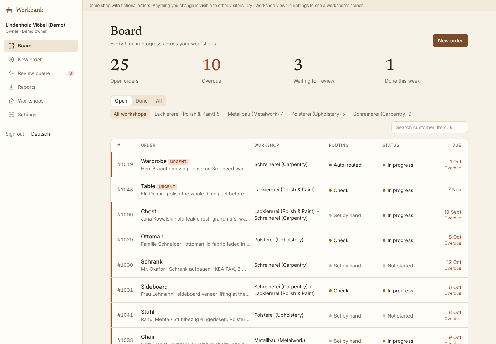
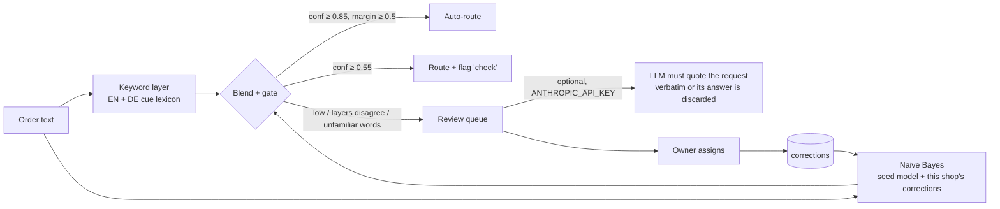
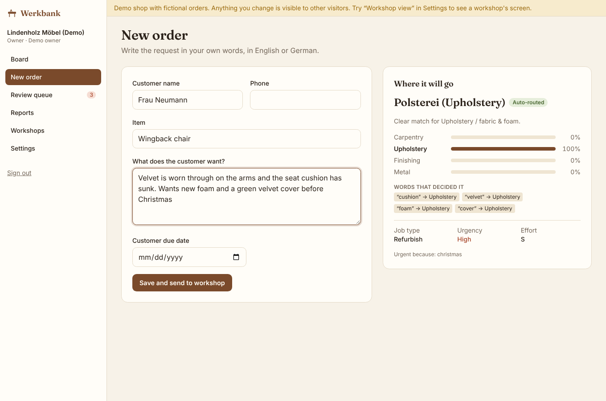
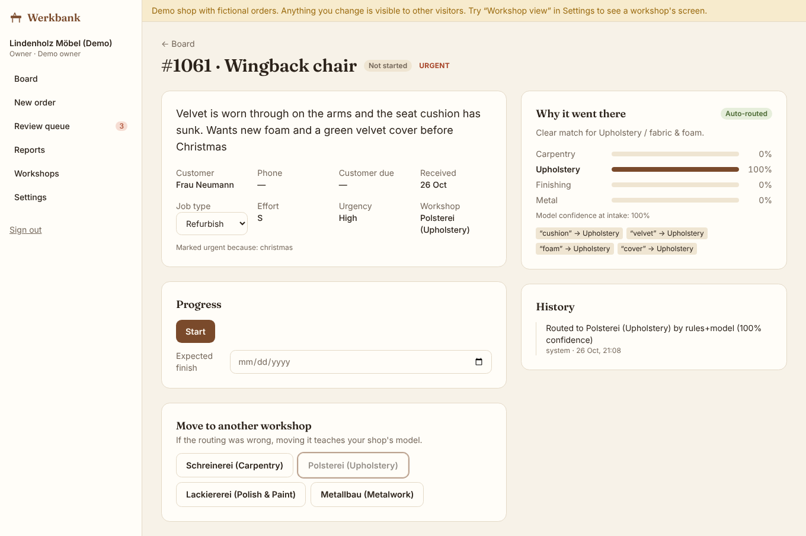
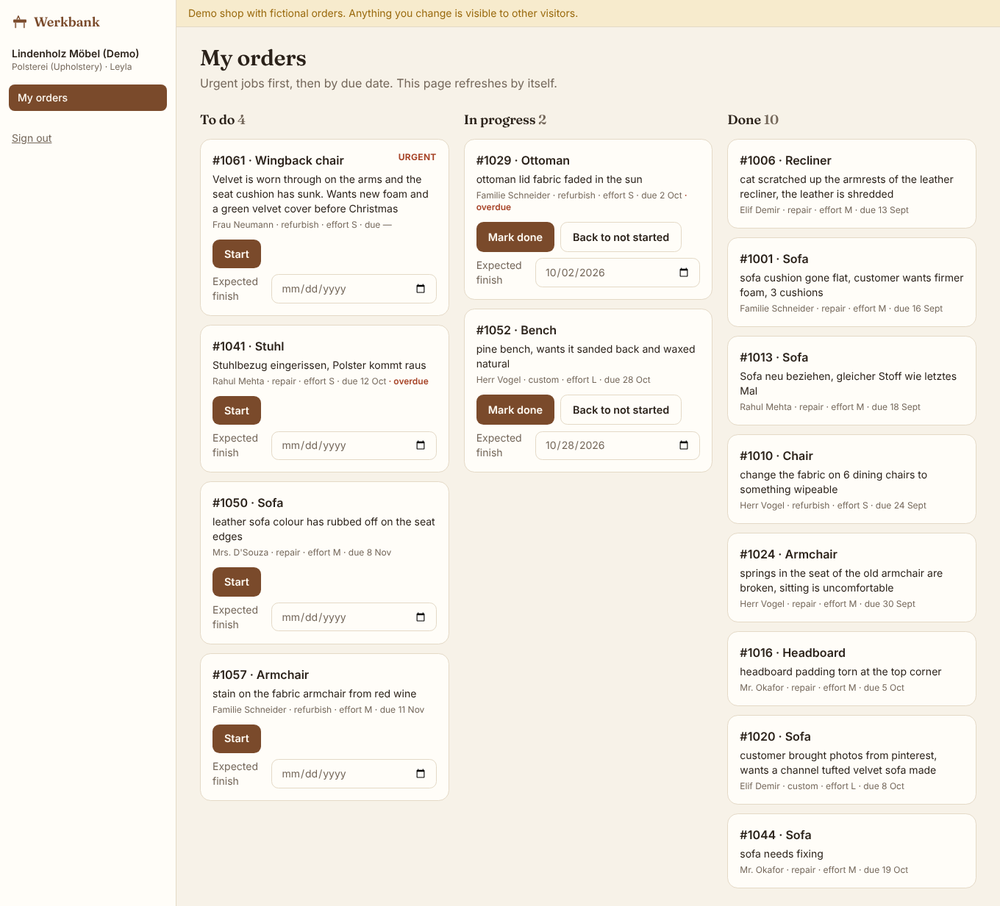
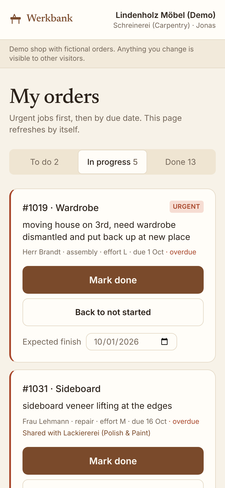

# Werkbank

**Order routing for furniture shops that run their own workshops.**
The shop owner types a customer request the way they would write a job slip. Werkbank sends it to the right
workshop (carpentry, upholstery, polish and paint, metalwork), labels it with a job type, urgency and effort, and
reports how confident it is. Requests it is not sure about wait in a review queue instead of going to the wrong
bench. Every correction the owner makes retrains that shop's model.

Live demo: **https://werkbank-gamma.vercel.app**. Click *Open the demo shop*; no sign-up needed. The demo shop is fictional.



## Why this exists

The project started from a real client brief: a furniture retailer with three in-house workshops wanted orders
to reach the right workshop automatically, with each workshop seeing only its own jobs. Werkbank generalises that
brief into a multi-tenant product any shop can sign up for.

Existing tools in this space are manufacturing ERPs built for cabinet and joinery shops: cut lists, CNC output and
job costing, priced around $50–$200 a month. None of them read a free-text repair request and decide which
in-house workshop should take it. That gap is what Werkbank fills.

## What it does

| Owner | Workshop staff |
|---|---|
| Live preview of the routing while typing an order | Own login that only shows that workshop's orders |
| One board for all workshops, overdue orders highlighted | Urgent jobs first, then sorted by due date |
| Review queue for low-confidence orders, with the model's best guess | One tap for *Start* or *Mark done*, plus an expected finish date |
| Reassigning an order teaches the shop's model | The board refreshes itself every few seconds |
| Reports: open, overdue, done and turnaround per workshop; monthly volume; CSV export | |
| Router strictness (strict, balanced, relaxed) and plan selection | |

It installs as an app on phone and desktop (PWA), and all data is stored server-side in Postgres. Pricing is
either a subscription (Starter €29/month, Pro €59/month) or a one-time licence (€790). Payments are **not** connected
in this build: picking a plan only records it on the account.

## How the routing works



- **Capabilities, not workshop names.** The model predicts one of four canonical capabilities. Each shop maps its
  own workshops onto them ("Polsterei" handles upholstery), so one model serves every shop.
- **Cheap layers first.** A weighted cue lexicon and a multinomial naive Bayes model run in under a millisecond.
  Naive Bayes was chosen because it updates incrementally: one correction just adds counts, with no training job.
- **Calibrated confidence.** Naive Bayes is notoriously over-confident. Its log-probabilities are tempered by a
  temperature fitted on held-out phrasings (`scripts/train.ts`). The UI never shows more than "99%+".
- **Refuses to guess.** The order goes to review if the request has almost no recognised words, if the keyword
  layer and the model strongly disagree, if the margin is thin, or if the shop has no workshop for the predicted
  capability.
- **The LLM gets the residue only.** It is called only for orders already in review. It must return a quote from
  the request, and if the quote is not literally in the text, its answer is thrown away. An LLM decision is never
  marked as fully automatic.
- **Every decision is explainable.** The order page shows the probabilities, the words that decided it, the gate,
  and a history of every routing and status change.
- **Second-level labels.** Job type (repair, custom, refurbish, assembly) comes from a second naive Bayes model.
  Urgency and effort are rules, because they depend on a few explicit words and the due date, and a shop owner can
  read a rule. "No rush" is handled before "rush".

## Evaluation

There is no public dataset of furniture-shop job tickets, so the seed model trains on **synthetic** requests
(`scripts/generate-data.ts`). To keep the numbers honest:

- the test set uses sentence templates **and** item and problem synonyms that never appear in training;
- a separate set of 60 **hand-written** messy requests (English, German, some deliberately vague) is used only for testing;
- gate thresholds were fixed before looking at test results. Searching for them on validation data collapsed to
  the minimum, so the search was dropped (the reason is noted in `scripts/train.ts`).

Results (full report: [`reports/eval.md`](reports/eval.md), re-run with `npm run eval`):

| Test set | Auto-routed | Auto accuracy | Sent to review | Accuracy of all routed |
|---|---|---|---|---|
| Synthetic, unseen phrasing (n=800) | 18.9% | 95.4% | 36.1% | 84.0% |
| Hand-written (n=60) | 40.0% | 95.8% | 23.3% | 93.5% |

**The feedback loop is the point.** A shop whose staff phrase things differently corrects its first *k* orders;
the model is then measured on 400 later orders:

| Corrections | Top-1 accuracy | Auto-routed | Auto accuracy | Review queue |
|---|---|---|---|---|
| 0 | 75.5% | 20.8% | 97.6% | 34.8% |
| 50 | 92.0% | 63.7% | 99.2% | 12.5% |
| 100 | 96.8% | 82.5% | 99.7% | 6.3% |

Limitations, plainly: synthetic test data is easier than real tickets, so real-world accuracy is unknown until a
shop uses it. The 400-correction row in the full report is close to in-distribution and should not be quoted. Job
type accuracy (70%) is mediocre. Single-capability routing does not split multi-workshop jobs; a "also involves"
hint is shown instead.

## Multi-tenancy and security

- Every tenant table carries `shop_id`. All SQL lives in [`src/lib/repo.ts`](src/lib/repo.ts) and filters on the
  caller's shop. Workshop users are additionally pinned to their own `workshop_id`, whatever filter they send.
- Owner-only operations (create order, reassign, reports, export, settings) are enforced server-side, not just hidden in the UI.
- Shop owners sign in with Google (OpenID Connect, authorization code + PKCE, ID token checked for issuer, audience,
  nonce and verified email). Workshop staff sign in with a globally unique username and a password that their owner
  sets and can reset; there is no email reset. Sessions are HS256-signed JWTs in an httpOnly cookie, passwords are
  hashed with bcrypt, and in production the app refuses to start without `AUTH_SECRET`. Known limits: no login
  rate limiting, and a reset password does not end sessions that are already open (they expire after 14 days).
  Setup: [`docs/google-auth-setup.md`](docs/google-auth-setup.md).
- [`tests/tenancy.test.ts`](tests/tenancy.test.ts) checks these rules against a real (in-memory) Postgres.

## Stack

Next.js 15 (App Router) · TypeScript · Tailwind CSS 4 · Postgres (Neon in production, PGlite in dev and tests) ·
jose · bcryptjs · Vitest · Playwright for the visual walkthrough. No ORM: around 20 parameterised queries in one file.

## Run it locally

```bash
npm install
npm run dev          # http://localhost:3000, data in ./.pglite, demo shop seeded on first start
npm test             # 23 tests: classifier + tenant isolation
npm run model        # regenerate data, retrain, re-evaluate
```

No database install is needed locally: PGlite runs Postgres in-process.

## Deploy

1. Import the repo on Vercel.
2. Add a Postgres database (*Storage → Neon*), which sets `DATABASE_URL`.
3. Set `AUTH_SECRET` to a long random string (`openssl rand -base64 32`).
4. For owner sign-in, `GOOGLE_CLIENT_ID` and `GOOGLE_CLIENT_SECRET` (see [`docs/google-auth-setup.md`](docs/google-auth-setup.md)).
   Without them the owner buttons are disabled; the demo and staff logins still work.
5. Optional: `ANTHROPIC_API_KEY` for the LLM step, and `RESEND_API_KEY` + `MAIL_FROM` for "order done" emails.

Without `DATABASE_URL`, the app still runs on Vercel with an in-memory database. That is fine for a quick look,
but data resets and is not shared between server instances.

## Screenshots

| New order with live routing | Why it went there |
|---|---|
|  |  |

| A workshop's view | Phone |
|---|---|
|  |  |

## Not built (yet)

Payments (Stripe), WhatsApp alerts, native store apps (the PWA covers install), splitting one order across two
workshops, and photo attachments.
